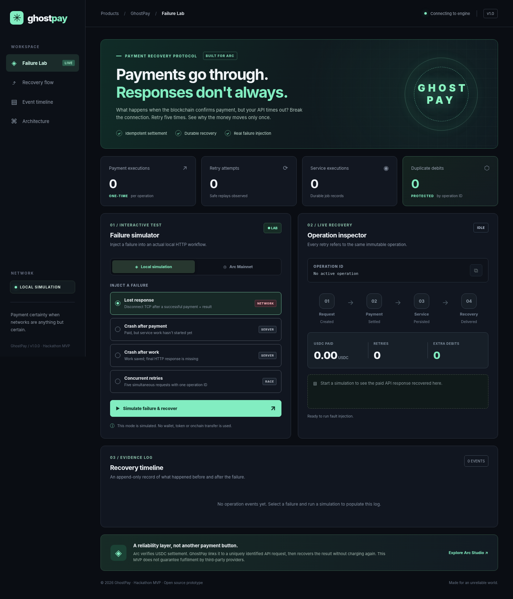

# GhostPay

Payment recovery for USDC-paid APIs, built on Arc.

Sometimes a payment succeeds, but the API response gets lost. The client retries the request and risks paying twice.

GhostPay solves this by linking each payment to a unique operation ID. Repeating the same operation doesn't transfer USDC again, and the original result can be recovered.



## Links

- **Live app:** https://arc-studio-cfe64d9dabbe491f8a5b1e9a.vercel.app/
- **Arc Mainnet:** https://arc-studio-cfe64d9dabbe491f8a5b1e9a.vercel.app/arc-pay
- **Demo video:** https://youtu.be/eXDUhj5iWEM

## How it works

1. A client creates an operation with a unique ID.
2. The payment is recorded on Arc, and the API result is stored.
3. If the request fails or times out, the client retries with the same ID.
4. GhostPay checks the existing payment and returns the saved result without charging again.

The Failure Lab demonstrates this with lost responses, server crashes and concurrent requests.

## Arc Mainnet

GhostPay is deployed on Arc Mainnet (chain ID `5042`) and has been tested with real USDC.

**Contract:** [0xa651aaCB6Bb20263ec5Ac8df243adda01a1CF9e6](https://explorer.arc.io/address/0xa651aaCB6Bb20263ec5Ac8df243adda01a1CF9e6)

- [PaymentRecorded](https://explorer.arc.io/tx/0xeea582b5493a9ffb53cb3a0acfffcb34007aeb19055e4dd51709840a1b6ef032) — first payment of 0.10 USDC
- [PaymentReplayed](https://explorer.arc.io/tx/0xf541ea5b35c82b0de0ebb7a4dc459313c688c5b2b2ff6030ea58657cbf624c70) — same operation, no second USDC transfer

The web app also supports MetaMask payments and on-chain receipt recovery.

## Tech stack

- Solidity 0.8.24 — payment contract
- Node.js — API and recovery logic
- Turso (libSQL) — persistent operation storage
- JavaScript — frontend and wallet integration
- Vercel — hosting

Built with **Arc Studio**.

## Run locally

Requires Node.js 22.13+.

```bash
npm run dev
```

Open `http://127.0.0.1:4173`.

Run tests:

```bash
npm test
```

The local demo uses simulated payments and SQLite. No wallet is required.

## Notes

GhostPay is a hackathon prototype, not an audited production payment system. The Failure Lab uses simulated payments; the linked Arc Mainnet transactions use real USDC.

MIT License.
